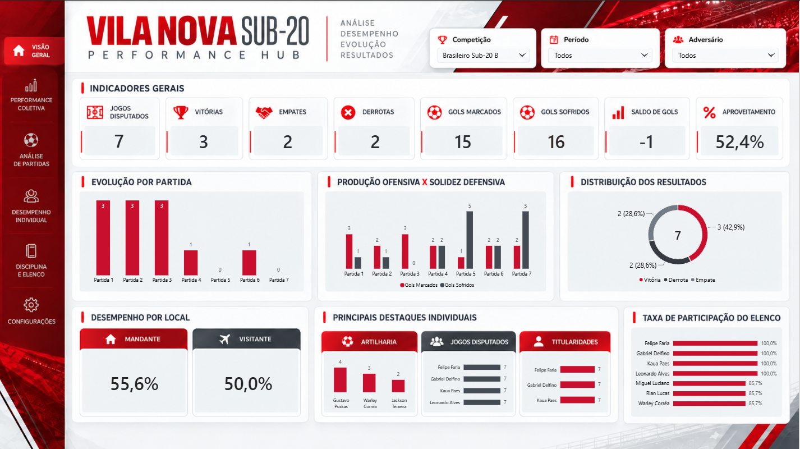
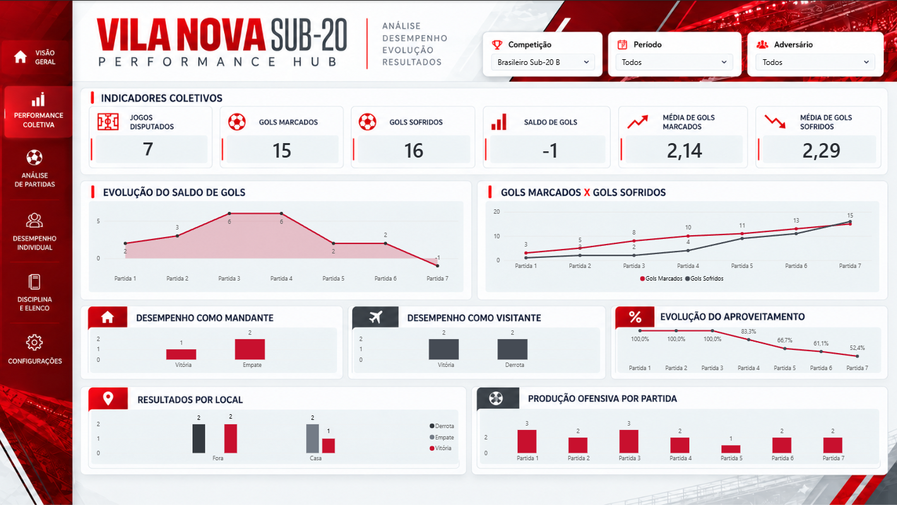
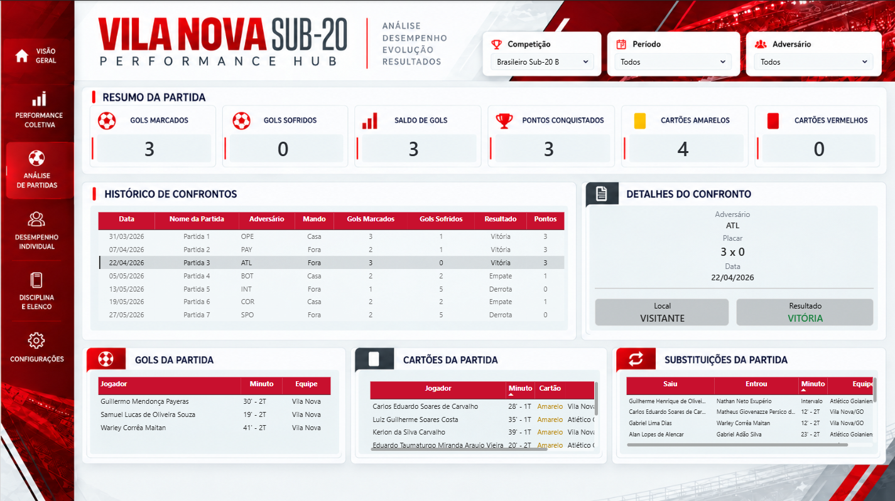
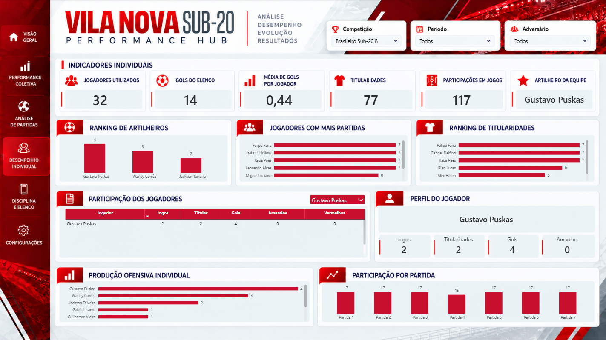
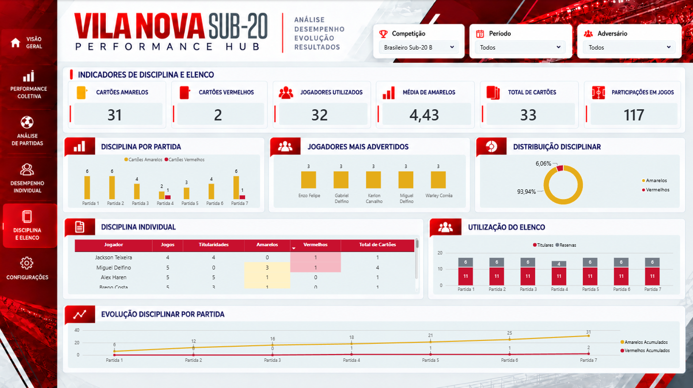

# Vila Nova Sub-20 Performance Hub 

**Análise de desempenho esportivo do Vila Nova Sub-20 no Campeonato Brasileiro Sub-20 B de 2026**, desenvolvida com **Python e Power BI**, a partir de dados de súmulas oficiais da CBF.

O projeto transforma registros de partidas, jogadores, gols, cartões e substituições em um painel interativo com cinco páginas, permitindo explorar resultados coletivos, confrontos, desempenho individual e disciplina.

> **Escopo:** 7 partidas analisadas. Os indicadores representam esse recorte e não necessariamente a temporada completa.

## Indicadores do recorte

| Indicador | Resultado |
|---|---:|
| Partidas | 7 |
| Vitórias | 3 |
| Empates | 2 |
| Derrotas | 2 |
| Pontos | 11 |
| Aproveitamento | 52,4% |
| Gols marcados | 15 |
| Gols sofridos | 16 |
| Saldo de gols | -1 |
| Jogadores utilizados | 32 |
| Participações em jogos | 117 |
| Cartões amarelos | 31 |
| Cartões vermelhos | 2 |

**Nota metodológica:** o total de 15 gols inclui um gol contra do adversário a favor do Vila Nova; os 14 gols atribuídos ao elenco consideram apenas os gols marcados por atletas da equipe. Participações em jogos correspondem a titularidades e entradas em campo, não a simples presença na lista de relacionados.

## Páginas do dashboard

### 01 - Visão Geral

Resumo de resultados, evolução por partida, gols marcados e sofridos, desempenho como mandante e visitante e destaques individuais.



### 02 - Performance Coletiva

Evolução do saldo de gols, produção ofensiva, gols acumulados, aproveitamento e comparação de resultados por local.



### 03 - Análise de Partidas

Histórico de confrontos e detalhes dinâmicos da partida selecionada, incluindo gols, cartões e substituições.



### 04 - Desempenho Individual

Rankings de artilharia, partidas e titularidades, tabela de jogadores e perfil individual interativo.



### 05 - Disciplina e Elenco

Distribuição e evolução de cartões, jogadores advertidos, disciplina individual e utilização do elenco por partida.



## Tecnologias utilizadas

- **Python:** organização, limpeza, tratamento e validação dos dados.
- **Power Query:** transformação e preparação das tabelas no Power BI.
- **Power BI:** modelagem de dados, medidas DAX, visualizações e interações.
- **DAX:** indicadores de resultados, desempenho coletivo e individual, cartões e evolução acumulada.
- **Git e GitHub:** versionamento de código, organização e documentação do projeto.
- **Bibliotecas Python:** Pandas, Requests, BeautifulSoup e PyMuPDF.

## Processo de desenvolvimento

1. **Coleta:** consolidação de dados de sete súmulas oficiais da CBF.
2. **Tratamento:** padronização de campos e estruturação de bases de partidas, atletas, gols, cartões e substituições.
3. **Modelagem:** construção de tabelas de dimensão e fato, relacionamentos e medidas.
4. **Validação:** conferência de totais, estatísticas individuais e comportamento dos filtros.
5. **Visualização:** desenvolvimento de cinco páginas interativas com identidade visual consistente.

## Estrutura do repositório

```text
vila-nova-sub20-performance-hub/
├── README.md
├── .gitignore
├── requirements.txt
├── dashboard/
│   └── Vila-Nova-Sub20-Performance.pbix
├── imagens/
│   ├── pagina-01.png
│   ├── pagina-02.png
│   ├── pagina-03.png
│   ├── pagina-04.png
│   └── pagina-05.png
├── dados/
│   └── tratados/
│       ├── dim_jogadores_2026.csv
│       ├── fato_cartoes_amarelos_2026.csv
│       ├── fato_cartoes_vermelhos_2026.csv
│       ├── fato_gols_2026.csv
│       ├── fato_jogadores_partidas_2026.csv
│       ├── fato_substituicoes_2026.csv
│       └── partidas_vila_nova_2026.csv
└── python/
    ├── pipeline/       # Extração, tratamento e auditoria
    └── exploracao/     # Scripts de investigação das fontes
```

## Fonte e limitações

- **Fonte primária:** súmulas oficiais da Confederação Brasileira de Futebol (CBF), referentes às sete partidas analisadas.
- As estatísticas se limitam aos eventos registrados nas súmulas e aos campos tratados no projeto.
- O dashboard não pretende medir métricas de rastreamento ou desempenho físico não presentes na fonte.
- Este é um projeto independente de portfólio, sem vínculo oficial com o Vila Nova Futebol Clube ou com a CBF.

## Execução do projeto

Para preparar o ambiente Python, clone o repositório e instale as dependências:

No Windows (PowerShell):

```powershell
.\.venv\Scripts\Activate.ps1
python -m pip install -r requirements.txt
```

### Auditoria dos dados

Para executar a auditoria dos dados tratados, utilize o comando abaixo na raiz do projeto:

```powershell
python python/pipeline/21_auditoria_final.py
```

A auditoria verifica a correspondência entre os eventos das partidas e os registros dos jogadores, contribuindo para a consistência das informações utilizadas no dashboard.

Os scripts estão organizados em duas pastas:

```bash
git clone https://github.com/phfbr/vila-nova-sub20-performance-hub-.git
cd vila-nova-sub20-performance-hub-
python -m venv .venv
```

No Windows (PowerShell):

```powershell
.\.venv\Scripts\Activate.ps1
python -m pip install -r requirements.txt
```

Os scripts estão organizados em duas pastas:

- **`python/pipeline/`** — extração, tratamento, estruturação e auditoria dos dados.
- **`python/exploracao/`** — investigação das fontes e testes utilizados durante o desenvolvimento.

Os arquivos CSV tratados estão disponíveis em `dados/tratados/` e podem ser utilizados para explorar os dados do projeto.

**Observação:** os documentos brutos da CBF não estão incluídos no repositório. A execução integral do pipeline exige a obtenção desses documentos. Para visualizar o dashboard, utilize o arquivo `.pbix` disponível na pasta `dashboard/`, com o Power BI Desktop.

---
**Projeto de portfólio em análise de dados e Business Intelligence.**
